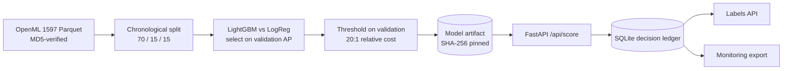
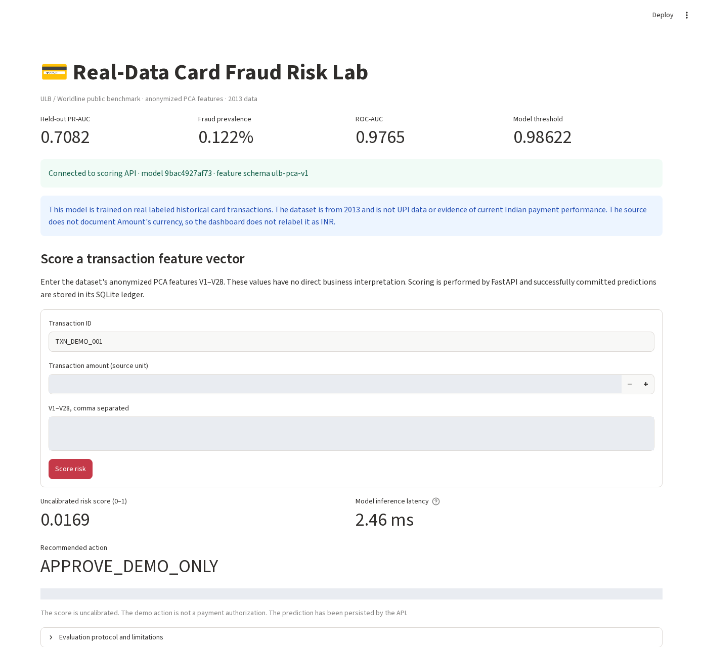

# Card Fraud Risk Scoring Pipeline

[](https://github.com/sachin2967/fraud-risk-scoring-pipeline/actions/workflows/ci.yml)


A reproducible fraud-modeling project on the public ULB / Worldline card-fraud dataset
(OpenML 1597), plus a small serving layer that treats scoring as an auditable,
restart-safe decision process rather than a stateless function.

> **Scope.** This is a real-data research benchmark and a single-host serving pilot,
> not a production fraud service. The data is two days of anonymized 2013 transactions.
> Nothing here validates current payment behavior, INR losses or live authorization.

## Highlights

- **Leakage-aware evaluation:** chronological 70/15/15 split; `Time` is used only for
  ordering; model and threshold are chosen on validation, and the test window is
  touched once.
- **Honest metrics for a 0.12% base rate:** average precision is reported against
  prevalence, alongside ROC-AUC, Brier score and a confusion matrix.
- **Durable decisions:** every score is committed to a SQLite ledger before the API
  acknowledges it. Retries with the same ID and payload return the original decision;
  reusing an ID with a different payload returns `409`.
- **Delayed labels:** labels are attached later with a declared source, and bounded
  exports feed downstream monitoring (see
  [model-monitoring-drift-platform](https://github.com/sachin2967/model-monitoring-drift-platform)).
- **Safe-by-default operations:** production mode requires an operator key, a trusted
  model SHA-256 and persistent state; request bodies are capped; the container runs
  as non-root.

## Results

Held-out test window: 42,721 transactions, 52 fraud cases (prevalence 0.122%).

| Metric | Value |
| --- | ---: |
| Selected model | Standardized, class-weighted logistic regression |
| Validation average precision (LogReg / LightGBM) | 0.840 / 0.821 |
| Test average precision (prevalence baseline 0.00122) | **0.708** |
| Test ROC-AUC | **0.977** |
| Recall at validation-selected threshold | 0.750 (39 TP, 13 FN) |
| Precision at validation-selected threshold | 0.459 (46 FP) |
| Modeled relative cost (20:1 FN:FP) vs approve-all | 306 vs 1,040 |
| In-process single-row latency p95 (100 warmed calls) | 1.43 ms |

Caveats that matter: scores are **uncalibrated** ranking scores, the 20:1 cost ratio is
an assumption (not measured INR cost), and one chronological split cannot quantify
temporal variability. Full details are in the [model card](docs/MODEL_CARD.md).

Local HTTP replay (300 requests, concurrency 4, durable writes): about 68.8 req/s,
P95 177.7 ms, and predictions and labels survived a forced process restart. That
**did not meet a 50 ms P95 target**; it is a laptop measurement, not a cloud SLA.

### Exploratory stability and calibration

The study selects a candidate on expanding windows inside the original training
period. It uses separate chronological windows for calibration and policy selection.
The test window has been inspected before, so this comparison is exploratory.

The selected candidate was `lgbm_7`. These results do not change the
serving artifact or the benchmark above.

| Test scores | Average precision | ROC-AUC | Brier score |
| --- | ---: | ---: | ---: |
| Raw | 0.7568 | 0.9788 | 0.006664 |
| Sigmoid calibration | 0.7568 | 0.9788 | 0.000424 |

The [study report](stability_benchmark_report.json) includes fold results, the
calibration and policy boundaries, and illustrative cost sensitivity. This short
historical series cannot establish current fraud calibration or operating costs.

```bash
OMP_NUM_THREADS=1 OPENBLAS_NUM_THREADS=1 python scripts/evaluate_stability.py
```

## Architecture



See [docs/ARCHITECTURE.md](docs/ARCHITECTURE.md) for the request lifecycle and failure
behavior.

## Quickstart

Requires Python 3.11.

```bash
git clone https://github.com/sachin2967/fraud-risk-scoring-pipeline.git
cd fraud-risk-scoring-pipeline
python -m venv .venv && source .venv/bin/activate     # Windows: .\.venv\Scripts\Activate.ps1
pip install -r requirements.txt
make train        # downloads the pinned dataset, trains, writes report + model
make api          # http://127.0.0.1:8000/docs
make dashboard    # Streamlit cockpit, in a second terminal
make test         # lint and tests
```

The first training run downloads the public dataset and verifies its checksum. To work
offline, place the matching file at `data/raw/openml_1597_creditcard.parquet`. The raw
data and the trained model are not committed.

### Docker

```bash
docker compose up --build
```

A one-shot training service builds the model into a named volume; the API and dashboard
bind to loopback (`8010` and `8510` by default).

### Dashboard scoring

Keep FastAPI running while using Streamlit. Set `FRAUD_API_URL` if the API is
running on a different address, and provide the same `FRAUD_API_KEY` to the
Streamlit server when authentication is enabled.



The dashboard sends scoring requests to FastAPI. A successful response includes
the prediction ID from the durable ledger. The screenshot uses a held-out
historical transaction with its amount, PCA features, and prediction ID masked.

### Score a transaction

```bash
curl -s -X POST http://127.0.0.1:8000/api/score \
  -H 'Content-Type: application/json' -H "X-API-Key: $FRAUD_API_KEY" \
  -d '{"transaction_id":"txn-001","pca_features":[0,0,0,0,0,0,0,0,0,0,0,0,0,0,0,0,0,0,0,0,0,0,0,0,0,0,0,0],"amount":42.5}'
```

The response contains an uncalibrated score and an illustrative action label. It is not
a transaction authorization.

## API

| Route | Purpose |
| --- | --- |
| `GET /live` | Process liveness |
| `GET /ready`, `/health` | Model, configuration and storage checks |
| `POST /api/score` | Score and durably record a decision (idempotent per ID and payload) |
| `POST /api/predictions/{id}/label` | Attach a later label with a declared source |
| `GET /api/predictions` | Bounded, cursor-paginated export for monitoring |
| `GET /api/benchmark` | Benchmark report |

## Operations

`APP_ENV=production` requires `FRAUD_API_KEY` (32+ characters), an absolute persistent
`FRAUD_STATE_PATH` and a trusted `FRAUD_MODEL_SHA256`. Non-health routes require
`X-API-Key`. Failed inference or storage returns `503` and callers may safely retry the
same ID and payload. Backups, restore and rollback are covered in
[docs/OPERATIONS.md](docs/OPERATIONS.md); `.env.example` lists the variables.

Export a training-only reference for drift monitoring with
`python scripts/export_monitoring_reference.py`.

## Repository layout

| Path | Responsibility |
| --- | --- |
| `scripts/evaluate_openml_benchmark.py` | Download, split, train, select, evaluate, write report |
| `src/models/`, `src/features/` | Estimators and feature pipeline |
| `src/serving/` | HTTP boundary and SQLite decision store |
| `api/app.py` | FastAPI application |
| `streamlit_app/` | Demonstration dashboard |
| `data/generate_dataset.py` | Legacy synthetic generator (kept as a utility only) |
| `tests/` | Split boundaries, selection, API and dashboard contracts, retries, conflicts, failures, backup |
| `docs/` | Architecture, model card, operations |

## Limitations and responsible use

- The data is historical and narrow; it cannot establish current performance.
- PCA features prevent transaction-level explanation, and there are no account, device,
  merchant or geography signals, so account-disjoint evaluation is impossible.
- One short temporal split cannot show stability across periods or attack campaigns.
- Cost weights are illustrative; replace them with measured costs and review capacity
  before choosing any operating threshold.
- Do not use these scores to approve, challenge or block real customers. Real use needs
  representative licensed data, calibration, human review, load and security testing,
  and formal risk governance.
- No UPI data or rules are included.

## Related projects

[Model monitoring](https://github.com/sachin2967/model-monitoring-drift-platform) ·
[Seller quality intelligence](https://github.com/sachin2967/seller-quality-intelligence) ·
[ADK commerce analyst](https://github.com/sachin2967/google-adk-multi-agent-analyst) ·
[LeetCode mentor](https://github.com/sachin2967/leetcode-knowledge-system)

## License

MIT. The dataset is third-party; follow the terms on its
[OpenML record](https://www.openml.org/d/1597).
