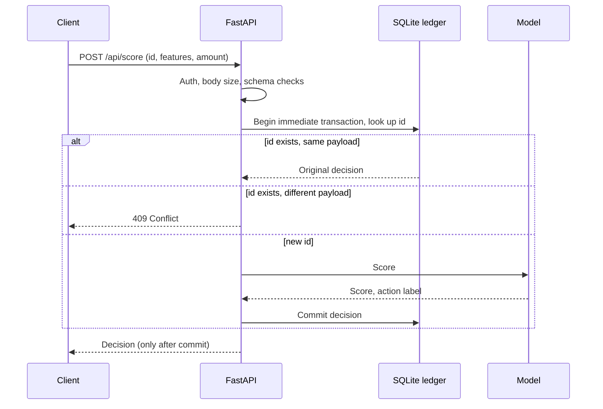

# Architecture

## Training and evaluation

1. Download the pinned OpenML Parquet file and verify its MD5 ETag.
2. Order rows by `Time` and split chronologically: 70% train, 15% validation, 15% test.
   `Time` is excluded from model features.
3. Fit two candidates: class-weighted LightGBM and standardized class-weighted logistic
   regression. Select by validation average precision.
4. Choose the action threshold on validation data using a declared 20:1 false-negative
   to false-positive relative cost. An "approve everything" cutoff is always a candidate.
5. Evaluate once on the test window and write `real_data_benchmark_report.json`.
6. Persist the model artifact (ignored by Git) and record its SHA-256.

## Serving request lifecycle

Key properties:

- **Commit before acknowledge.** A successful response implies the decision is durable.
- **Idempotent retries.** The ledger keys on ID plus a payload hash.
- **Serialized writes.** An immediate transaction orders competing submissions; this
  is a single-host design, not high availability or horizontal scaling.
- **Fail closed on dependencies.** Model or storage failure returns `503`; `/live`
  (process) and `/ready` (model, configuration, storage) are separate.
- **Labels arrive later.** `POST /api/predictions/{id}/label` records the label, its
  source and server receipt time; conflicting labels need an audited correction.
- **Monitoring handoff.** `GET /api/predictions` exports bounded pages. Re-export
  earlier rows to pick up later labels; the cursor is not a label change feed.

## Trust boundaries

- Only operator-trusted joblib artifacts are loaded; production mode pins the hash.
- The operator API key stays server-side and is not a multi-user identity system.
- Backups use the SQLite online backup API and refuse to overwrite.
